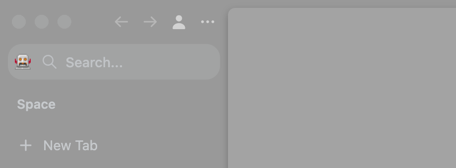

# Profile Button

A [Sine](https://github.com/CosmoCreeper/Sine) mod for [Zen Browser](https://zen-browser.app) that adds a profiles button to the top-left toolbar, next to back and forward.

Click it to:

- see which profile you're in
- switch to another profile (it opens in its own window)
- create, edit or manage profiles

It uses Zen's built-in profiles panel, so everything looks and works the same as the profiles option in the app menu, just one click away.

## Install

Open Zen's settings, go to **Sine Mods**, search for **Profile Button** in the marketplace and click **Install**.

### Installing from GitHub before it's in the store

1. In **Sine Mods**, turn on **Enable installing JS from unofficial sources**. Sine only runs scripts from store mods unless this is on.
2. Paste `https://github.com/Jprdgza/zen-profile-button` into the install box.
3. Restart Zen.

## Settings

| Setting                                                      | What it does                                                 |
| ------------------------------------------------------------ | ------------------------------------------------------------ |
| Show the current profile's avatar instead of the person icon | Replaces the person icon with your current profile's avatar. |

## Moving the button

Right-click the toolbar, choose **Customize Toolbar…**, and drag the button wherever you want.

## Notes

- **Profiles have to be turned on.** Zen's newer profile system (the one with avatars and colors) is what the panel uses. If your build has it turned off, the button opens `about:profiles` instead.
- **First time:** if you haven't made a second profile yet, the button shows Zen's "Create a profile" panel.

## License

[MIT](LICENSE)
